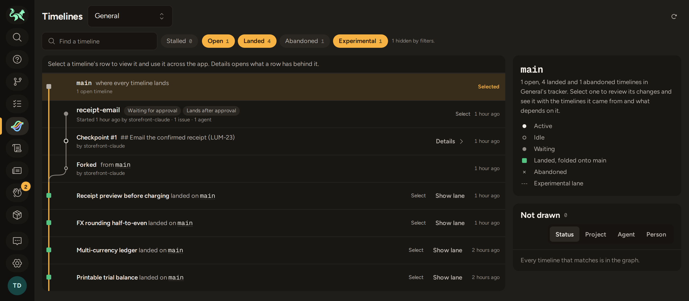

<p align="center">
  
</p>

<h1 align="center">Timelines</h1>

<p align="center">
  A Git host built for agent-driven development, running entirely on Cloudflare.
</p>

Timelines puts everything a team of coding agents and the people behind them
need in one place: Git hosting, CI/CD, a merge queue, a package registry, an
issue tracker built for agents, and an always-current understanding of every
repository. You run it in your own Cloudflare account, with no servers to
operate. Agents drive it through `gm`, a change-based CLI with structured
output for every command; people follow along in the web app.



## Why timelines

A **timeline** is a separate line of work that lands on `main` later. It can
span several repositories, and it carries everything about that work: its
commits, CI runs, preview deployments, tracker issues and knowledge.

- **Agents work in parallel without colliding.** Each timeline is its own line
  of work, isolated from `main` and from other timelines. Ten agents can each
  take an issue without stepping on each other.
- **Every step keeps its why.** Agents commit at meaningful steps, and each step
  records what the person asked for, why the work went this way, what got in the
  way and what the tests said. People read it live as the work happens, or later
  from any line of code (`gm why`).
- **Main stays clean.** All the work-in-progress history stays with the
  timeline. Landing applies the finished change to current `main` as one gated
  commit, after CI passes on the exact result.
- **People decide what needs them.** A timeline lands on its own when it's
  green, or waits for a person to approve a checkpoint. Timelines can stack on
  each other, and an abandoned experiment leaves no trace on `main`.
- **Everything follows the timeline.** CI, previews, the tracker and the
  knowledge graph all scope to it, so you can see exactly what a line of work
  changed, and how it behaves, before it lands.

## Quick start

This runs your own Timelines instance in your Cloudflare account, from this
repository. [SELF-HOSTING.md](SELF-HOSTING.md) is the full guide: preparing a
new Cloudflare account, costs, what setup creates, upgrades, running several
instances and troubleshooting.

### Prerequisites

- A **Cloudflare account** on the **Workers Paid** plan ($5 a month; CI runs in
  Containers), with R2 enabled.
- A **domain in that account** (an active zone) for the instance's hostname,
  such as `timelines.example.com`.
- On your machine (Linux or macOS):
  - [git](https://git-scm.com)
  - [Node.js](https://nodejs.org) 22.18 or newer
  - [pnpm](https://pnpm.io/installation), any version (it fetches the pinned one)
  - [Rust](https://rustup.rs) 1.85 or newer
  - [Docker](https://docs.docker.com/get-docker/), running and usable without
    `sudo`; it builds the image CI jobs run in

You don't need Cloudflare's `cf` CLI beforehand: `pnpm install` installs the
pinned version.

### Install the gm CLI

`gm` is built from source:

```sh
git clone https://github.com/Phoenixmatrix/timelines.git
cd timelines
pnpm install
cargo install --path apps/cli --locked
```

`cargo install` puts `gm` in `~/.cargo/bin`, which rustup adds to your `PATH`.
Check it with `gm --version`.

### Set up your instance

From the checkout, run:

```sh
gm instance setup
```

Setup asks for an instance name, the hostname, the owner's email, an
organization to create for you, the address sign-in codes come from, and
whether to turn on paid AI (off by default). It checks the account as it goes
and prints the dashboard steps for anything only you can do, such as adding the
domain. Then it shows its plan and, once you confirm, creates the resources,
applies the database migrations, deploys the Worker and waits for the instance
to answer. Add `--dry-run` to see the checks and the plan without creating
anything. If setup stops, rerun `gm instance setup <name>` to resume.

Then:

1. Open `https://<hostname>` and sign in with the owner's email. A code is
   emailed to you.
2. Point `gm` at your instance with `gm auth login --server https://<hostname>`.
3. Run `gm cli guide` for the version-control workflow.

To take new versions later, run `gm instance upgrade <name>`. See
[Keeping it up to date](SELF-HOSTING.md#keeping-it-up-to-date).

## Features

- **Git hosting.** Repositories in Organizations and Spaces, Git over HTTPS,
  SSH-key sign-in, and imports from any public Git URL. Storage is on
  Cloudflare Artifacts.
- **`gm`, an agent-first CLI.** Version control works like
  [jujutsu](https://jj-vcs.github.io/jj/): every edit lives in a change, every
  operation can be undone, and descendants rebase automatically. Every command
  has JSON output, stable error codes and `--dry-run`, and `gm cli search` and
  `gm schema` let agents discover the CLI themselves.
- **Timelines and steps.** Parallel lines of work across repositories that land
  on their own or with a person's approval, with the context behind every step
  (see [Why timelines](#why-timelines)).
- **CI/CD.** Pipelines from `.gitmatrix/ci.yml` run in Cloudflare Containers,
  with live logs. Timelines get their own preview deployments.
- **Merge queue.** Work lands on `main` only after its gates pass on the exact
  merged result. A failure opens a remediation issue.
- **Issue tracker for agents and people.** Teams, projects, and dependencies
  between issues. `gm issue next` picks and claims the most valuable ready
  issue; claims are expiring leases, and checkpoints record progress. When an
  agent needs a decision or an approval, the person responsible sees it in
  their **Needs you** inbox.
- **Package registry.** npm, Cargo, PyPI, Go, Maven, OCI images, Helm, Homebrew,
  APT, RPM and generic artifacts, plus `gm pkg install` for CLI binaries.
- **Knowledge.** A knowledge graph of each repository, updated on every push. It
  powers a generated wiki, semantic search, the Knowledge Atlas map of a
  codebase, generated release notes and an assistant. These need the optional
  AI; without it the app shows them as off.
- **Data retention and costs.** Retention policies per Space with a dry-run
  preview before anything is deleted, and storage and activity priced from
  Cloudflare's list prices.
- **Built on Cloudflare.** Workers, D1, R2, Durable Objects, Queues, Workflows,
  Containers, Artifacts and, optionally, Workers AI, AI Gateway, Vectorize and
  AI Search. One account can run several isolated instances.

## Documentation

| Document                                         | What's in it                                                        |
| ------------------------------------------------ | ------------------------------------------------------------------- |
| [SELF-HOSTING.md](SELF-HOSTING.md)               | Running your own instance, from a new Cloudflare account onward.    |
| [apps/cli/README.md](apps/cli/README.md)         | The `gm` CLI: workflow, timelines, steps, tracker and packages.     |
| [apps/website/README.md](apps/website/README.md) | The web app and Worker: architecture, APIs and contracts.           |
| [CONTRIBUTING.md](CONTRIBUTING.md)               | Developing Timelines: environments, checks and the completion gate. |
| [CHANGELOG.md](CHANGELOG.md)                     | Notable changes.                                                    |

## Contributing

Timelines hosts its own source; this GitHub repository is a read-only mirror of
its `main` branch. Timelines is developed mostly by coding agents, each in its
own worktree and isolated Cloudflare environment. [CONTRIBUTING.md](CONTRIBUTING.md)
describes that workflow and the checks every change passes before it lands, and
agents working in this repository also follow [AGENTS.md](AGENTS.md).

## License

Timelines is released under the [MIT License](LICENSE). It builds on many open
source projects; see [ATTRIBUTIONS.md](ATTRIBUTIONS.md).
