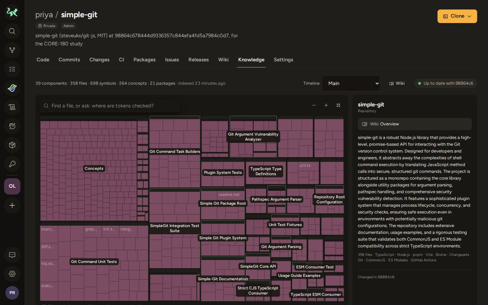
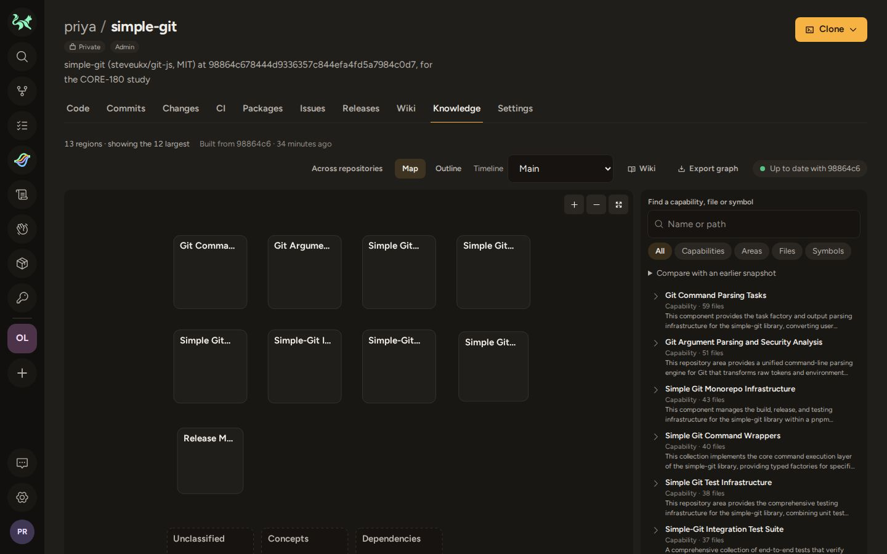
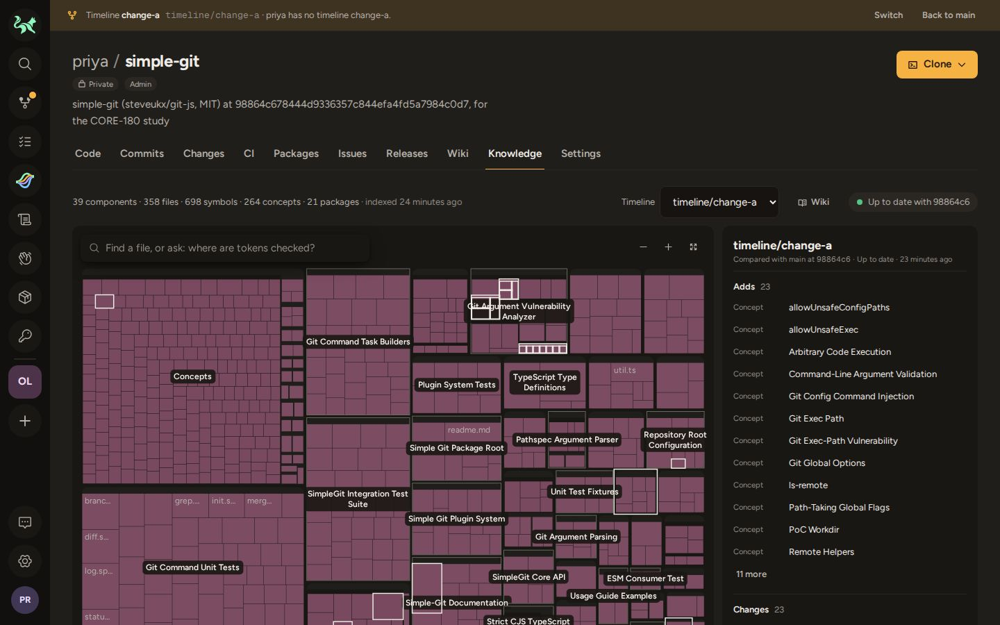
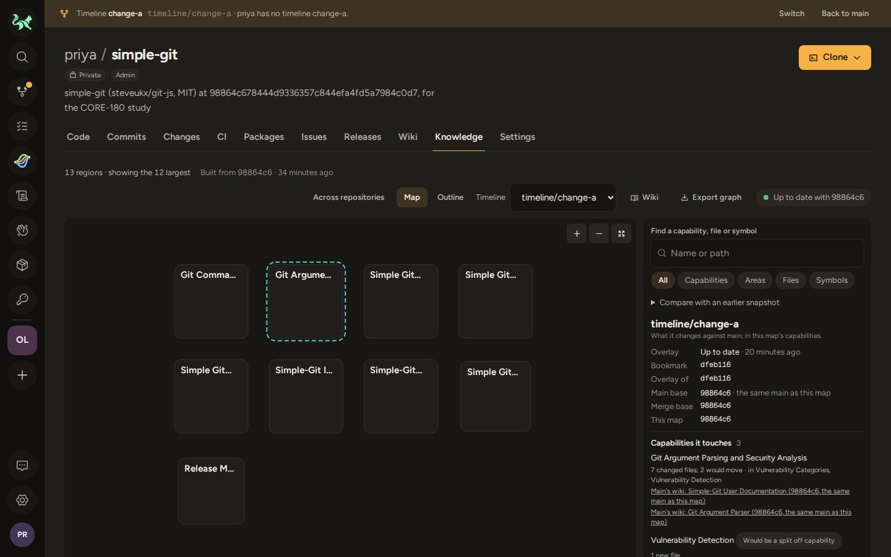

# CORE-180: five-engineer comparative usability study

The last gate of the Semantic Code Atlas PRD (CORE-155, acceptance gate 20):

> Compare the current atlas and proposed experience with five engineers using an
> unfamiliar representative repository and equivalent tasks: find a capability, cite
> two sources, identify direct dependents, and explain timeline changes. At least four
> of five participants complete each task in the new experience; median
> orientation-plus-change-understanding time is at least 25% lower than the baseline,
> with no worse source-location accuracy. Record task ground truth, ordering,
> completion, timing, and accuracy so learning effects and incorrect-but-fast answers
> cannot be reported as success.

A person runs the sessions; this directory has everything else.

| File                                               | What it is                                                                                   |
| -------------------------------------------------- | -------------------------------------------------------------------------------------------- |
| [task-script.md](task-script.md)                   | Facilitator script: consent, instructions, think-aloud, warm-ups, prompts, timing rules      |
| [ground-truth.md](ground-truth.md)                 | Correct answers per task and variant, how each was derived, and the completion rules         |
| [ground-truth.json](ground-truth.json)             | The machine-derived facts behind ground-truth.md                                             |
| [derive-ground-truth.mjs](derive-ground-truth.mjs) | Derives ground-truth.json from the study repository's Git objects, and checks it             |
| [ordering.csv](ordering.csv)                       | Counterbalanced condition order and variant assignment for P1 to P5                          |
| [recording-sheet.csv](recording-sheet.csv)         | The timing and recording sheet: one row per participant × condition × task                   |
| [analyze.mjs](analyze.mjs)                         | Computes completion, medians, improvement and accuracy, and the gate verdict, from the sheet |
| [study-env.sh](study-env.sh)                       | Stands up, checks and destroys the two isolated study environments                           |
| [screenshots.mjs](screenshots.mjs)                 | Captures each condition's starting screens in a fresh browser context                        |
| [screenshots/](screenshots/)                       | The dry run's starting screens                                                               |

## Design

**Within-subjects, two conditions.** Every participant uses both:

- **baseline**: the Knowledge experience before the cutover, "current atlas plus
  search": Gitmatrix at `75de1f32` (CORE-170), the parent of the CORE-174 cutover
  commit `770b0599`. Its Knowledge tab is the old whole-repository map with the
  inspector, search and the timeline overlay panel.
- **new**: the Atlas Knowledge experience on main (capability territory, outline,
  inspector and lens, lookup, Atlas timeline).

**Two parallel task variants**, A and B, so nothing learned in the first condition
answers the second. Each has the same four task types in the same order (T1 find a
capability, T2 cite two sources, T3 identify direct dependents, T4 explain a
timeline's changes) in different parts of the repository: variant A is the
unsafe-operation protection (`packages/argv-parser` and simple-git's plugins), variant
B is diff and stat summaries (simple-git's tasks, parsers and responses). Each prompt
is self-contained. See [task-script.md](task-script.md).

**Counterbalanced ordering** ([ordering.csv](ordering.csv)):

| Participant | First condition (variant) | Second condition (variant) |
| ----------- | ------------------------- | -------------------------- |
| P1          | baseline (A)              | new (B)                    |
| P2          | new (A)                   | baseline (B)               |
| P3          | baseline (B)              | new (A)                    |
| P4          | new (B)                   | baseline (A)               |
| P5          | new (A)                   | baseline (B)               |

P1 to P4 are a full 2×2 Latin square (condition order × variant). Five can't be
balanced, so P5 repeats P2's sequence, chosen to bias **against** the new
experience on both counts: the new experience comes first in 3 of 5 sessions (so
familiarity with the repository helps the baseline more often), and gets the larger
variant A in 3 of 5. The analysis also reports medians by variant and by position.

**One repository, same commit, same timelines, both conditions.** Both environments
are seeded identically (below) and build Knowledge for real, with AI enabled.

## Repository

[steveukx/git-js](https://github.com/steveukx/git-js) (the `simple-git` npm package),
**MIT licensed**, pinned at `98864c678444d9336357c844efa4fd5a7984c0d7` ("V4 (#1193)",
2026-09-23): 359 tracked files, 288 JavaScript/TypeScript files (155 source, 133 tests and fixtures) in
a small monorepo (`simple-git/` plus `packages/argv-parser`, `packages/args-pathspec`
and test packages).

Why this one: it is TypeScript of moderate size (a Knowledge build takes minutes, not
hours, and costs little); widely used but rarely read, so most engineers can be
screened as unfamiliar with its source; and organised by kind (`tasks/`, `parsers/`,
`responses/`, `plugins/`, a separate package), so its capabilities cross directories
and packages, which is what both conditions are being compared on. It has real,
recent upstream changes of the right size for the timeline task, and its relative
imports give an exact dependents ground truth.

The timelines are real upstream changes, never edited:

- `timeline/change-a` = `dfeb11648190b2d82a98c91768ec6e3a65bb401c`, the upstream child of
  the pinned commit ("Fix/exec path vulnerability (#1197)").
- `timeline/change-b` = `2b27941aae6b9e55439a3ecbf76f7f6c039609c0`: upstream `76f308e`
  ("Pr/1180 (#1195)") cherry-picked onto the pinned commit with its original author
  and committer, so the commit id is reproducible. `study-env.sh` checks it.

No third-party source is committed here: `study-env.sh` fetches the repository into
`~/.cache/gitmatrix-study/core-180/git-js`.

## Environment

`study-env.sh` creates one source worktree per condition next to this checkout
(`../gitmatrix-study-baseline` at `75de1f32`, `../gitmatrix-study-new` at main or
`--rev`), and in each runs the standard isolated agent workflow: `vp install`,
`vp run agent setup` (AI-enabled, its own Cloudflare resources and loopback origin),
then `vp run agent up` in the background. Never the canonical 5180 server. It then:

1. creates `priya/simple-git` (private, owned by the seeded persona priya) with
   `vp run agent gm -- repo create`;
2. pushes the pinned commit to `main` and the two timeline commits to
   `timeline/change-a` and `timeline/change-b` with plain git through
   `gm auth git-credential` (the environment's own sign-in);
3. waits until the Knowledge build of the pinned commit has succeeded, both
   timelines' overlays are up to date against it, and an Atlas snapshot is published
   at it, then writes the readiness report to
   `<worktree>/.gitmatrix-agent/study-core180.json`.

```sh
cd docs/studies/core-180
./study-env.sh up baseline              # ~75 minutes, mostly the Knowledge build
./study-env.sh up new --rev <commit>    # pin the commit; use the same one for every session
./study-env.sh check baseline           # "ready": true, plus build, Atlas and overlays
./study-env.sh origin new               # the loopback URL to open
./study-env.sh shots new                # starting screens into screenshots/
./study-env.sh destroy baseline         # resources, credentials and the worktree
```

Constraints: agent environments expire **24 hours** after setup, at most four live
per user, and each `up` pays for a Knowledge build (Workers AI analysis, wiki,
embeddings and AI Search indexing) plus two overlays. Model-written summaries and
capability names differ between builds, so all five sessions should use the same
two environments.

## Running the study

Once, before the first session:

1. Recruit five professional engineers who read TypeScript and have never read or
   contributed to simple-git's source (using the package is fine). Record anything
   else relevant (prior Gitmatrix use) in the sheet's notes.
2. Schedule all five sessions within one 24-hour window, then stand up both
   environments shortly before the first: `./study-env.sh up baseline` and
   `./study-env.sh up new --rev <main commit>`. Both must report `"ready": true`.
3. Pilot both conditions yourself once (all eight prompts, not timed) to confirm the
   environments match the screenshots and nothing is broken.

Each session (about 90 minutes, on the machine running the environments, or with the
participant controlling it through a screen share):

1. Check both environments (`./study-env.sh check …`).
2. Follow [task-script.md](task-script.md): consent, introduction, the first
   condition's warm-up and four tasks with its variant, a break, then the second
   condition in a **new** fresh browser profile, and the closing questions.
3. Fill in the participant's 8 rows in [recording-sheet.csv](recording-sheet.csv),
   scoring against [ground-truth.md](ground-truth.md). Keep recordings private.

After the fifth session:

```sh
node analyze.mjs recording-sheet.csv          # verdict; exit 0 pass, 1 fail, 2 incomplete
./study-env.sh destroy baseline && ./study-env.sh destroy new
```

Record the verdict and the sheet's numbers as CORE-180's completion evidence. Keep
the filled sheet out of this public repository unless participants agreed to that;
it holds only participant numbers, but notes can identify people.

## Analysis

Fixed before any data is collected; [analyze.mjs](analyze.mjs) implements exactly this.

- **Completion.** A task is completed when the outcome is `completed`: the answer
  meets the task's rule in [ground-truth.md](ground-truth.md) within 10 minutes. The
  gate needs **≥ 4 of 5** participants completing **each** of T1 to T4 in the new
  experience.
- **Orientation-plus-change-understanding time.** Per participant and condition, the
  sum of T1 to T4 times, where a task that wasn't completed (incorrect, passed or
  timed out) counts as **600 s** however fast it ended. The gate needs
  `(median_baseline − median_new) / median_baseline ≥ 25%` over the five participants.
- **Source-location accuracy.** Per condition, pooled over participants:
  correct locations ÷ cited locations, counting both T2 citations and every file
  listed in T3. The gate needs new ≥ baseline.
- The gate passes only when all three hold. Medians by variant, by position (first or
  second condition) and per task are reported for interpretation, not for the verdict.

## Dry run (2026-10-03)

Both conditions were stood up from scratch with `study-env.sh up`, checked, captured
and destroyed:

|                              | baseline                                                                      | new                                                                                                                                      |
| ---------------------------- | ----------------------------------------------------------------------------- | ---------------------------------------------------------------------------------------------------------------------------------------- |
| Gitmatrix                    | `75de1f32`                                                                    | `e12b30c5` (main)                                                                                                                        |
| Knowledge build of `98864c6` | succeeded, 67 min (16:34 to 17:42 UTC)                                        | succeeded, 70 min (16:35 to 17:45 UTC)                                                                                                   |
| Graph                        | 358 files, 698 symbols, 39 components, 264 concepts                           | 358 files, 704 symbols, 39 components, 272 concepts                                                                                      |
| Atlas snapshot               | #1 published (partial: 1 file's analysis failed); not shown in this condition | #1 published at `98864c6`, 13 regions, not partial                                                                                       |
| `timeline/change-a` overlay  | up to date at `dfeb116`, merge base `98864c6`                                 | up to date; Atlas regrouping computed (touches "Git Argument Parsing and Security Analysis", proposes a split "Vulnerability Detection") |
| `timeline/change-b` overlay  | up to date at `2b27941`, merge base `98864c6`                                 | up to date                                                                                                                               |

Starting screens ([screenshots/](screenshots/)): the Knowledge tab of
`priya/simple-git` on main and with `?tl=change-a`, for each condition.

| baseline                                                              | new                                                         |
| --------------------------------------------------------------------- | ----------------------------------------------------------- |
|              |        |
|  |  |

The two builds ran in parallel on one Cloudflare account; one alone may be faster.
Model-written names and summaries differ between the two environments (and would
differ again on a rebuild); the ground truth doesn't depend on them.

## Decisions for the owner

- **Repository.** simple-git at the pinned commit, as above. Swapping it means
  re-deriving the ground truth and rewriting the prompts.
- **Pinning the new condition.** `study-env.sh up new` defaults to main; pin `--rev`
  to the commit you dry-run, and use it for all five sessions.
- **Remote or in person.** The environments are loopback-only on the machine that
  runs them. Remote participants need remote control through a screen share.
- **Warm-up repository.** The seeded `marco/hello-world` has one file, so the warm-up
  only shows where the controls are. A richer neutral warm-up repository would need
  adding to `study-env.sh` (and its build adds cost and time).
- **Timeline banner.** The timelines are plain `timeline/*` bookmarks, so both
  conditions show "priya has no timeline change-a". Creating tracker timelines would
  remove it but lets them be landed or abandoned; the study keeps plain bookmarks.
- **Publishing results.** Whether the filled sheet and recordings may be committed or
  shared, per participants' consent.
